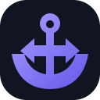
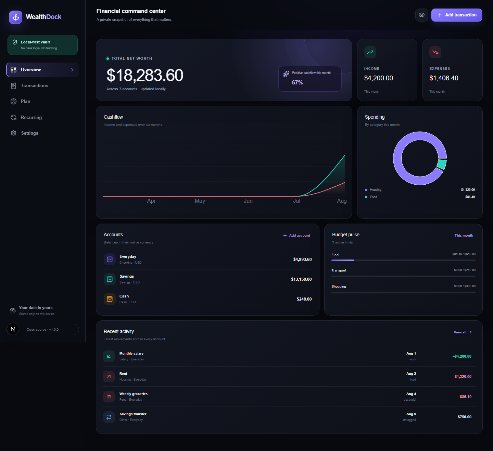

<p align="center">
  
</p>

<h1 align="center">WealthDock</h1>

<p align="center"><strong>Your finances. One clear place.</strong></p>

<p align="center">
  A private, local-first and open-source workspace for accounts, transactions,
  budgets, goals, debts and recurring money.
</p>

<p align="center">
  <a href="https://github.com/MrBoodj011/WealthDock/actions/workflows/ci.yml"></a>
  <a href="LICENSE"></a>
  
  
</p>



## Why WealthDock?

Most finance apps ask you to surrender bank credentials, personal history or a
monthly subscription before showing a chart. WealthDock takes the opposite
approach: the application works without an account, stores data in your browser
and makes every export available in open formats.

- **Local-first by default** — no telemetry, analytics, bank login or API token.
- **Encrypted at rest** — optional AES-256-GCM vault with PBKDF2-SHA256 key derivation.
- **Useful offline** — installable PWA with an offline application shell.
- **Portable** — validated JSON, spreadsheet-safe CSV and encrypted `.wdock` backups.
- **Auditable** — strict TypeScript, unit tests, browser tests and security scanning.

## Features

| Area        | Included                                                                 |
| ----------- | ------------------------------------------------------------------------ |
| Money       | Multi-account balances, income, expenses, transfers, categories and tags |
| Planning    | Monthly budgets, savings goals, debts and receivables                    |
| Automation  | Weekly, monthly and yearly recurring rules with review-before-posting    |
| Insights    | Net worth, six-month cashflow, category spending and budget progress     |
| Privacy     | On-device IndexedDB, privacy mode, encrypted vault and manual lock       |
| Portability | JSON backup/import, CSV import/export, encrypted backup and PDF report   |
| Delivery    | Responsive PWA, Docker image, CI, CodeQL, Dependabot and tagged releases |

## Quick start with npm

Requirements: Node.js 22 or newer and npm 10 or newer.

```bash
git clone https://github.com/MrBoodj011/WealthDock.git
cd WealthDock
npm ci
npm run dev
```

Open `http://localhost:3000`. WealthDock starts with clearly labelled demo data.
Reset it from **Settings → Reset local workspace** before entering real records.

### Quality commands

```bash
npm run lint
npm run typecheck
npm test
npm run test:e2e
npm run build
```

## Run with Docker

```bash
docker compose up --build
```

Open `http://localhost:3000`. No database or environment variables are required.

## Security model

WealthDock has no server-side financial database. In standard mode, the dataset
is stored in IndexedDB on the current browser profile. When vault encryption is
enabled, only an authenticated AES-GCM envelope is persisted and the passphrase
remains in memory for the active session.

Important limitations:

- Browser extensions or malware running with access to an unlocked browser can
  still read visible data.
- A forgotten vault passphrase cannot be recovered.
- Exchange rates are user-managed; WealthDock does not call a market-data API.
- Backups are the user's responsibility.

Read the full [threat model](docs/THREAT_MODEL.md) and report vulnerabilities
through [SECURITY.md](SECURITY.md). Do not open public issues for security reports.

## Architecture

```text
Next.js server shell
        │
        ▼
React client workspace
        │
        ├── finance engine (pure calculations)
        ├── validated domain schema (Zod)
        ├── import/export + PDF reporting
        └── local vault
             ├── standard IndexedDB record
             └── AES-GCM encrypted envelope
```

There is intentionally no GitHub-token-as-database integration. See
[ARCHITECTURE.md](docs/ARCHITECTURE.md) for the boundaries and design decisions.

## Contributing

Issues and pull requests are welcome. Start with [CONTRIBUTING.md](CONTRIBUTING.md),
follow the [Code of Conduct](CODE_OF_CONDUCT.md), and check the public
[roadmap](ROADMAP.md). Every behavior change should include tests.

## Creator

WealthDock is created and maintained by
[MrBoodj011](https://github.com/MrBoodj011).

## License

Copyright © 2026 MrBoodj011. WealthDock is licensed under the
[GNU Affero General Public License v3.0 or later](LICENSE).
